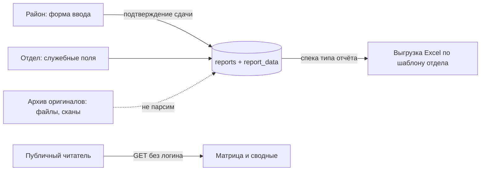

# excel-automation

🇬 English version: [see below](#english-version)

Система приёма и сведения отчётности бактериологического отдела.
33 района присылают результаты исследований на сальмонеллез и другие болезни
файлами, сканами и бумагой (иногда за 5 часов в одну сторону), отдел вручную
сводит их в пять итоговых Excel-таблиц и периодически ошибается в формулах.
excel-automation заменяет ручную сводку: ввод данных по районам с подтверждением
сдачи, публичный просмотр сводного состояния, выгрузка посчитанных итоговых
файлов в формате отдела и архив присланных оригиналов.

- Публично (без логина): просмотр сводной картины и скачивание итоговых файлов.
- Под логином: ввод данных района (роль района — только свой район), администрирование.
- Парсинга присланных файлов нет и не планируется: исходники хранятся как
  доказательная база, цифры вводятся руками и подтверждаются сдачей.

## Быстрый старт

```bash
git clone https://github.com/StAlien666/excel-automation.git
cd excel-automation
cp .env.example .env        # и поменяй пароли
docker compose up --build -d
```

- Публичная часть: http://localhost:8080/
- Вход: http://localhost:8080/login — `admin` / `admin` (пароль по умолчанию,
  создаётся один раз при пустой таблице `users`; меняй в БД).
- Проверка ролей: `/admin/ping` залогиненным админом.

Ожидаемые строки лога при старте:

```
Migrating schema "public" to version "1 - init schema"
Successfully applied 1 migration to schema "public", now at version v1
Создан администратор 'admin' с паролем по умолчанию. Смени его в БД!
Started ExcelAutomationApplication in ~7 s
```

Полный сброс базы (нормальная практика до прода):

```bash
docker compose down -v      # сносит том pgdata вместе со схемой
docker compose up -d --build
```

## Требования и конфигурация

- Docker + Docker Compose (рекомендуемый путь); либо локально: JDK 21, PostgreSQL 15+.
- Переменные окружения (читаются через `.env`, см. `.env.example`):

| Переменная | Назначение | По умолчанию |
|---|---|---|
| `POSTGRES_DB` / `POSTGRES_USER` / `POSTGRES_PASSWORD` | параметры БД в compose | см. `.env.example` |
| `SPRING_DATASOURCE_URL` | JDBC URL при запуске без докера | `jdbc:postgresql://localhost:5433/excel_automation` |
| `ADMIN_USERNAME` / `ADMIN_PASSWORD` | сид админа при ПЕРВОМ старте | `admin` / `admin` |

> Внимание: в `docker-compose.yml` URL базы содержит имя БД текстом
> (`.../excel_automation`), поэтому `POSTGRES_DB` должен совпадать с ним,
> либо правь URL в compose. Переменные `ADMIN_*` в compose-файл пока не
> прокинуты — для докера действуют значения по умолчанию из `application.yaml`.

## Архитектура



Ключевые решения (подробности — в ADR, раздел «Документация»):

- **Универсальное хранилище значений (Путь Б).** Одна таблица `report_data`
  (report_id, metric_key, value_month) на все типы отчётов; подписи, порядок
  колонок, производные и маппинг в Excel живут в коде — в «спеке» типа отчёта.
  Новый отчёт или изменившийся формат отдела = правка спеки + файл-шаблон,
  схема БД не меняется.
- **Производные не храним.** «С начала года», итоги и зависимые колонки
  вычисляются при чтении/выгрузке. Хранение производных — причина реальных
  ошибок в текущих ручных файлах (см. «Особенности исходных форматов»).
- **Период атомарно помесячно.** Полугодия и годы — производные представления;
  файлы за полугодие лежат в архиве с `period_month = NULL`.
- **Доступ:** любые GET публичны; запись — после входа; роли `ADMIN`
  и `DISTRICT_USER` (район правит только свой район).

## Структура репозитория

```
src/main/java/ru/alexandr/excel_automation/
├── config/        SecurityConfig, AdminSeeder, AsyncConfig
├── controller/    WebController (страницы), AdminController (проверка ролей)
├── entity/        District, User, Report, ReportData, ReportFile + enum'ы
├── repository/    Spring Data JPA-репозитории
└── service/       DbUserDetailsService, ReportService; ExcelProcessingService (задел)
src/main/resources/
├── db/migration/  V1__init_schema.sql — единственная миграция до прода
├── static/css/    дизайн-система app.css
└── templates/     Thymeleaf-страницы (login, index)
```

## База данных и миграции

До выхода в прод действует соглашение: **миграция одна (V1)**. Любое изменение
схемы = правка `V1__init_schema.sql` + пересоздание базы (`docker compose down -v`).
Миграции V2+ появляются только после объявления прода — решением владельца проекта.

## Соглашения разработки

- Код в репозиторий вносит только владелец проекта; внешние предложения
  (включая сгенерированные) сначала ревьюются и проверяются запуском.
- Комментарии и сообщения логов — по-русски: их читает отдел, а не только разработчики.
- README и docs обновляются в том же коммите, что и изменение поведения.
- Файлы передаются между разработчиком и помощником ТОЛЬКО целиком:
  правка = полный файл со всем старым содержимым, никогда не фрагмент.
- Крупные архитектурные решения фиксируются ADR-ом до реализации, а не после.

## Глоссарий

| Термин | Значение |
|---|---|
| Сдача | Одна запись `reports`: район + период + тип отчёта + версия |
| Версия сдачи | Повторная присылка исправлений за тот же период; старая не затирается |
| «За месяц» / «с н.г.» | Первичное значение / производное «с начала года» (не хранится) |
| Белые столбики | Ячейки шаблона отдела для ручного ввода (остальные — формулы) |
| Сводная | Итоговый лист/файл отдела по всем районам |
| Спека отчёта | Кодовое описание типа: метрики, подписи, порядок, производные, маппинг в Excel |
| ООВЛ | Областная лаборатория как отдельный сдающий субъект (в MVP не моделируется) |

## Особенности исходных форматов

- «Июльская болезнь»: в ручных файлах итоги за июль 2026 протянуты ошибочной
  формулой (Павлоградский: 41 вместо 91), ошибка тянется нарастающим итогом до декабря.
- Шапки районов «плавают»: у Полтавки данные начинаются на строку выше, чем у Калачинска.
- В январе «Итого за месяц» листа «по видам» считается из 12 слагаемых,
  с февраля — из 14; поведение отдела сохранено в спеке намеренно (требует подтверждения зав. отделом).
- Названия районов в файлах нестабильны («Колосовкий», «Оконешнековский»);
  канон — справочник `districts`, экспорт маппит строки по `sort_order`, а не по имени.
- Районы присылают результаты скринами и бумагой — поэтому ввод руками, а не парсинг.

## Документация

- `docs/adr/0001-universal-report-data.md` — универсальная таблица значений + спеки (в работе)
- `docs/adr/0002-server-side-rendering.md` — Thymeleaf против SPA (в работе)

## Лицензия и контакты

Внутренний проект; лицензия будет выбрана перед первым распространением.
Вопросы — владельцу репозитория.

---

# English version

## excel-automation

Intake and consolidation system for a veterinary bacteriology department.
33 districts submit research results (salmonellosis and other diseases) as files,
scans and paper — sometimes hand-delivered over a 5-hour trip — while the department
manually consolidates them into five summary Excel workbooks, occasionally erring
in formulas. excel-automation replaces the manual consolidation: per-district data
entry with submission confirmation, a public status overview, computed summary Excel
exports in the department's exact format, and an archive of received originals.

- Public (no login): status overview and summary downloads.
- Authenticated: district data entry (a district user edits only its district), admin.
- No parsing of received files, by design: originals are stored as evidence,
  numbers are entered manually and confirmed by submission.

## Quick start

```bash
git clone https://github.com/StAlien666/excel-automation.git
cd excel-automation
cp .env.example .env        # then change the passwords
docker compose up --build -d
```

- Public site: http://localhost:8080/
- Login: http://localhost:8080/login — `admin` / `admin` (seeded once while the
  `users` table is empty; change it in the DB afterwards).
- Role check: `/admin/ping` as an authenticated admin.

Expected log lines on startup:

```
Migrating schema "public" to version "1 - init schema"
Successfully applied 1 migration to schema "public", now at version v1
Started ExcelAutomationApplication in ~7 s
```

Full database reset (normal practice pre-production):

```bash
docker compose down -v
docker compose up -d --build
```

## Requirements and configuration

- Docker + Compose (recommended); or locally: JDK 21, PostgreSQL 15+.
- Environment variables via `.env` (see `.env.example`): `POSTGRES_DB/USER/PASSWORD`,
  `SPRING_DATASOURCE_URL`, `ADMIN_USERNAME/ADMIN_PASSWORD` (admin seed, first start only).

| Variable | Purpose | Default |
|---|---|---|
| `POSTGRES_DB` / `POSTGRES_USER` / `POSTGRES_PASSWORD` | DB parameters for compose | see `.env.example` |
| `SPRING_DATASOURCE_URL` | JDBC URL when running without Docker | `jdbc:postgresql://localhost:5433/excel_automation` |
| `ADMIN_USERNAME` / `ADMIN_PASSWORD` | admin seed at FIRST start | `admin` / `admin` |

> Note: `docker-compose.yml` embeds the DB name in the JDBC URL, so `POSTGRES_DB`
> must match it (or edit the URL). `ADMIN_*` are not passed through compose yet —
> in Docker the `application.yaml` defaults apply.

## Architecture


Key decisions (details in ADRs, see Documentation):

- **Universal value storage.** A single `report_data` table (report_id, metric_key,
  value_month) serves all report types; labels, column order, derived values and the
  Excel mapping live in code — in the report type "spec". A new report or a changed
  department format = spec edit + template file, no schema change.
- **Derived values are never stored.** Year-to-date totals and dependent columns are
  computed on read/export; storing derived numbers is exactly how the current manual
  workbooks acquired real errors (see Source format quirks).
- **Month is the atomic period.** Half-year and year views are derived; half-year
  files live in the archive with `period_month = NULL`.
- **Access:** all GETs are public; writes require login; roles `ADMIN` and
  `DISTRICT_USER` (a district edits only its own district).

## Repository structure

```
src/main/java/ru/alexandr/excel_automation/
├── config/        SecurityConfig, AdminSeeder, AsyncConfig
├── controller/    WebController (pages), AdminController (role check)
├── entity/        District, User, Report, ReportData, ReportFile + enums
├── repository/    Spring Data JPA repositories
└── service/       DbUserDetailsService, ReportService; ExcelProcessingService (stub)
src/main/resources/
├── db/migration/  V1__init_schema.sql — the single pre-production migration
├── static/css/    design system app.css
└── templates/     Thymeleaf pages (login, index)
```

## Database and migrations

Pre-production convention: **a single migration (V1)**. Any schema change = edit
`V1__init_schema.sql` + recreate the database (`docker compose down -v`).
V2+ migrations appear only after production is declared, by owner's decision.

## Development conventions

- Only the project owner commits to the repository; external suggestions
  (including generated ones) are reviewed and verified by running first.
- Comments and log messages are in Russian: the department reads them, not only developers.
- README and docs are updated in the same commit as the behaviour change.
- Files are exchanged between the developer and the assistant ONLY in full:
  a change = the complete file with all previous content, never a fragment.
- Major architectural decisions are recorded as ADRs before implementation, not after.

## Glossary

| Term | Meaning |
|---|---|
| Submission (сдача) | One `reports` row: district + period + report type + version |
| Submission version | A re-sent correction for the same period; the old one is kept |
| "Per month" / "YTD" | Primary value / derived "year to date" (never stored) |
| White columns | Template cells meant for manual entry (the rest are formulas) |
| Summary (сводная) | The department's consolidated sheet/file across districts |
| Report spec | Code-side description of a type: metrics, labels, order, derived values, Excel mapping |
| OOVL | The regional lab as a separate submitting subject (not modeled in MVP) |

## Source format quirks

- "July disease": July 2026 totals in the manual workbooks use a broken dragged
  formula (Pavlogradskiy: 41 instead of 91), propagating through YTD columns until December.
- District file headers drift (Poltavka starts one row above Kalachinsk).
- The January "month total" on the "by species" sheet uses 12 terms, February onward 14 —
  preserved deliberately, pending department head confirmation.
- District names are unstable across files; the `districts` dictionary is canonical,
  export maps rows by `sort_order`, not by name.
- Districts submit screenshots and paper — hence manual entry, not parsing.

## Documentation

- `docs/adr/0001-universal-report-data.md` — universal value table + specs (in progress)
- `docs/adr/0002-server-side-rendering.md` — Thymeleaf vs SPA (in progress)

## License and contacts

Internal project; a license will be chosen before the first distribution.
Questions — to the repository owner.