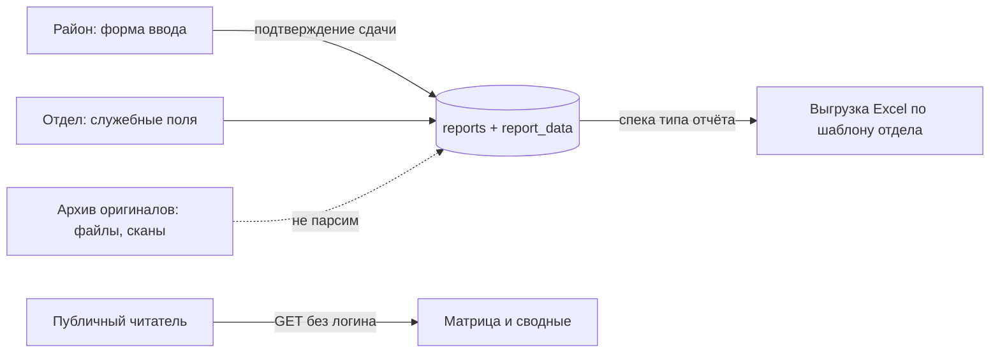

# excel-automation

🇬 English version: [see below](#english-version)

Система приёма и сведения отчётности бактериологического отдела.
33 района присылают результаты исследований на сальмонеллез и другие болезни
файлами, сканами и бумагой (иногда за 5 часов в одну сторону), отдел вручную
сводит их в пять итоговых Excel-таблиц и периодически ошибается в формулах.
excel-automation заменяет ручную сводку: ввод данных по районам с подтверждением
сдачи, публичный просмотр сводного состояния, выгрузка посчитанных итоговых
файлов в формате отдела и архив присланных оригиналов.

- Публично (без логина): просмотр сводной картины и скачивание итоговых файлов.
- Под логином: ввод данных района (роль района — только свой район), администрирование.
- Парсинга присланных файлов нет и не планируется: исходники хранятся как
  доказательная база, цифры вводятся руками и подтверждаются сдачей.

## Быстрый старт

```bash
git clone https://github.com/StAlien666/excel-automation.git
cd excel-automation
cp .env.example .env        # и поменяй пароли
docker compose up --build -d
```

- Публичная часть: http://localhost:8080/
- Вход: http://localhost:8080/login — `admin` / `admin` (пароль по умолчанию,
  создаётся один раз при пустой таблице `users`; меняй в БД).
- Проверка ролей: `/admin/ping` залогиненным админом.

Ожидаемые строки лога при старте:

```
Migrating schema "public" to version "1 - init schema"
Successfully applied 1 migration to schema "public", now at version v1
Создан администратор 'admin' с паролем по умолчанию. Смени его в БД!
Started ExcelAutomationApplication in ~7 s
```

Полный сброс базы (нормальная практика до прода):

```bash
docker compose down -v      # сносит том pgdata вместе со схемой
docker compose up -d --build
```

## Требования и конфигурация

- Docker + Docker Compose (рекомендуемый путь); либо локально: JDK 21, PostgreSQL 15+.
- Переменные окружения (читаются через `.env`, см. `.env.example`):

| Переменная | Назначение | По умолчанию |
|---|---|---|
| `POSTGRES_DB` / `POSTGRES_USER` / `POSTGRES_PASSWORD` | параметры БД в compose | см. `.env.example` |
| `SPRING_DATASOURCE_URL` | JDBC URL при запуске без докера | `jdbc:postgresql://localhost:5433/excel_automation` |
| `ADMIN_USERNAME` / `ADMIN_PASSWORD` | сид админа при ПЕРВОМ старте | `admin` / `admin` |

> Внимание: в `docker-compose.yml` URL базы содержит имя БД текстом
> (`.../excel_automation`), поэтому `POSTGRES_DB` должен совпадать с ним,
> либо правь URL в compose. Переменные `ADMIN_*` в compose-файл пока не
> прокинуты — для докера действуют значения по умолчанию из `application.yaml`.

## Архитектура



Ключевые решения (подробности — в ADR, раздел «Документация»):

- **Универсальное хранилище значений (Путь Б).** Одна таблица `report_data`
  (report_id, metric_key, value_month) на все типы отчётов; подписи, порядок
  колонок, производные и маппинг в Excel живут в коде — в «спеке» типа отчёта.
  Новый отчёт или изменившийся формат отдела = правка спеки + файл-шаблон,
  схема БД не меняется.
- **Производные не храним.** «С начала года», итоги и зависимые колонки
  вычисляются при чтении/выгрузке. Хранение производных — причина реальных
  ошибок в текущих ручных файлах (см. «Особенности исходных форматов»).
- **Период атомарно помесячно.** Полугодия и годы — производные представления;
  файлы за полугодие лежат в архиве с `period_month = NULL`.
- **Доступ:** любые GET публичны; запись — после входа; роли `ADMIN`
  и `DISTRICT_USER` (район правит только свой район).

## Структура репозитория

```
src/main/java/ru/alexavr/excel_automation/
├── config/        SecurityConfig, AdminSeeder, AsyncConfig
├── controller/    WebController (страницы), AdminController (проверка ролей)
├── entity/        District, User, Report, ReportData, ReportFile + enum'ы
├── repository/    Spring Data JPA-репозитории
└── service/       DbUserDetailsService, ReportService; ExcelProcessingService (задел)
src/main/resources/
├── db/migration/  V1__init_schema.sql — единственная миграция до прода
├── static/css/    дизайн-система app.css
└── templates/     Thymeleaf-страницы (login, index)
```

## База данных и миграции

До выхода в прод действует соглашение: **миграция одна (V1)**. Любое изменение
схемы = правка `V1__init_schema.sql` + пересоздание базы (`docker compose down -v`).
Миграции V2+ появляются только после объявления прода — решением владельца проекта.

## Соглашения разработки

- Код в репозиторий вносит только владелец проекта; внешние предложения
  (включая сгенерированные) сначала ревьюятся и проверяются запуском.
- Комментарии и сообщения логов — по-русски: их читает отдел, а не только разработчики.
- README и docs обновляются в том же коммите, что и изменение поведения.
- Крупные архитектурные решения фиксируются ADR-ом до реализации, а не после.

## Глоссарий

| Термин | Значение |
|---|---|
| Сдача | Одна запись `reports`: район + период + тип отчёта + версия |
| Версия сдачи | Повторная присылка исправлений за тот же период; старая не затирается |
| «За месяц» / «с н.г.» | Первичное значение / производное «с начала года» (не хранится) |
| Белые столбики | Ячейки шаблона отдела для ручного ввода (остальные — формулы) |
| Сводная | Итоговый лист/файл отдела по всем районам |
| Спека отчёта | Кодовое описание типа: метрики, подписи, порядок, производные, маппинг в Excel |
| ООВЛ | Областная лаборатория как отдельный сдающий субъект (в MVP не моделируется) |

## Особенности исходных форматов

- «Июльская болезнь»: в ручных файлах итоги за июль 2026 протянуты ошибочной
  формулой (Павлоградский: 41 вместо 91), ошибка тянется нарастающим итогом до декабря.
- Шапки районов «плавают»: у Полтавки данные начинаются на строку выше, чем у Калачинска.
- В январе «Итого за месяц» листа «по видам» считается из 12 слагаемых,
